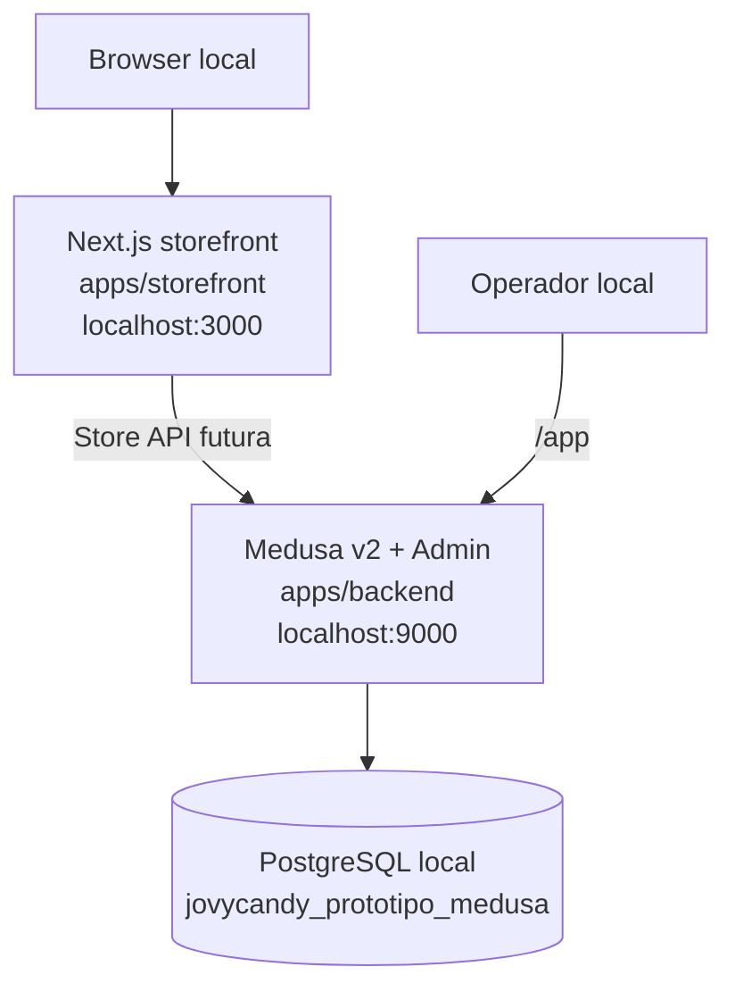

# Arquitectura inicial

**Estado:** implementada parcialmente y validada por build. PostgreSQL y runtime de Medusa siguen bloqueados por autenticación local.



## Árbol relevante

```text
prototipo/
├── apps/
│   ├── storefront/
│   │   ├── src/app/                 # App Router oficial de Next.js
│   │   └── src/{features,components,lib,services,hooks,providers,config}/
│   └── backend/
│       ├── src/{api,modules,workflows,subscribers,jobs,admin,scripts}/
│       ├── medusa-config.ts
│       └── integration-tests/
├── docs/
├── scripts/
├── package.json
├── pnpm-workspace.yaml
└── pnpm-lock.yaml
```

El App Router quedó en `apps/storefront/src/app`, en lugar de `apps/storefront/app`, porque se eligió explícitamente `--src-dir` del generador oficial de Next.js. Es una variación documentada de la estructura objetivo y preserva las rutas internas solicitadas bajo `src/`.

## Aplicaciones

### Storefront

- Next.js `16.4.6`, React `19.3.0`, TypeScript `5.9.3`, Tailwind `4.3.3`.
- Página `/` técnica y estática; no consume Medusa todavía.
- Alias `@/*` y configuración de ESLint generada oficialmente.
- Directorios feature-first creados como cimientos; no contienen funcionalidades de negocio.

### Backend

- Medusa `2.22.6`, incluido Medusa Admin compilable.
- Configuración oficial en `medusa-config.ts` con `DATABASE_URL`, CORS y secretos de JWT/cookie por variables de entorno.
- Estructura oficial preservada para módulos, APIs, workflows, subscribers, jobs, extensiones Admin y scripts.
- La ausencia intencional de `REDIS_URL` usa la instancia fake que Medusa anuncia durante build; no se añade Redis a esta fase.

## Workspace y builds de dependencias

`pnpm-workspace.yaml` declara `apps/*` y reserva `packages/*` sin crear paquetes vacíos. La política de pnpm 11 permite exclusivamente scripts de build de `@medusajs/telemetry`, `@swc/core`, `esbuild`, `msgpackr-extract` y `protobufjs`, tras revisar que provienen del árbol generado por Medusa/Next. Otros scripts permanecen bloqueados por defecto.

No hay Git anidado y el lockfile autoritativo es `pnpm-lock.yaml` de la raíz. `create-next-app` dejó además `apps/storefront/pnpm-lock.yaml`, un metadato redundante pendiente de eliminación autorizada. La extracción del backend eliminó únicamente el wrapper temporal y sus dependencias creados por el generador oficial en un intento que no terminó.

## Decisiones pendientes

- Modelos CMS, rutas públicas, APIs y permisos granulares: posteriores a la base validada.
- Paquetes compartidos: solo se crearán si existe duplicación comprobada.
- PWA, sistema visual y assets: se evaluarán durante la fase de diseño.
- Redis, infraestructura externa, pagos, correo e integraciones: fuera del alcance actual.
