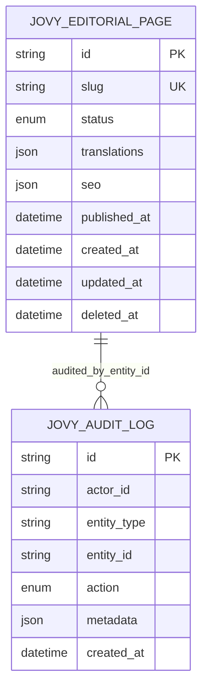

# Modelo de datos CMS

## Implementado: `jovy_content`

`translations` exige `es` y `en`; cada idioma tiene título y puede contener resumen/cuerpo. `seo` es parcial por idioma. El `slug` es único. Medusa DML aporta `created_at`, `updated_at` y `deleted_at` para soft delete.

## Diseñado, no implementado

- Marketing: banner, hero configuration y featured product; este último se enlazará al Product Module mediante Module Links cuando haya productos comerciales.
- Events: evento, tipo, medios gestionados por File Module y publicación programada.
- Gallery/Brand: entradas ordenadas que referencian IDs de File Module.
- Contact: solicitud, estado operativo y auditoría, sin relación pública de lectura.
