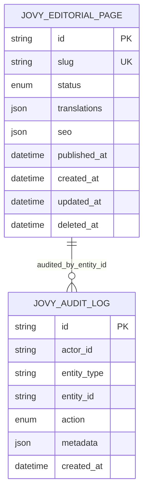
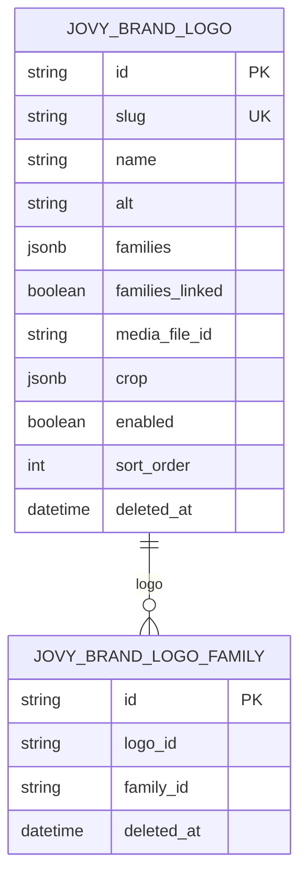
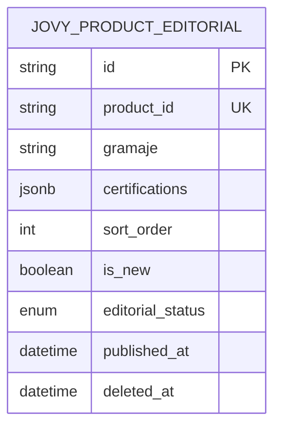

# Modelo de datos CMS

## Implementado: `jovy_content`



`translations` exige `es` y `en`; cada idioma tiene título y puede contener resumen/cuerpo. `seo` es parcial por idioma. El `slug` es único. Medusa DML aporta `created_at`, `updated_at` y `deleted_at` para soft delete.

## Implementado: `jovy_catalogue` y `jovy_launches`

```mermaid
erDiagram
  JOVY_CATALOGUE_CATEGORY {
    string id PK
    string key UK
    string name
    boolean active
    boolean coming_soon
    boolean interaction_locked
    string image_file_id
    string image_url
    string medusa_category_id
    int sort_order
    datetime deleted_at
  }
  JOVY_PRODUCT_FAMILY {
    string id PK
    string slug UK
    string name
    string description
    string medusa_category_id
    int sort_order
    boolean active
    datetime deleted_at
  }
  JOVY_LAUNCH {
    string id PK
    string product_id
    string title
    string description
    string image_file_id
    string image_url
    int sort_order
    boolean active
    datetime deleted_at
  }
  JOVY_LAUNCH_SETTINGS {
    string id PK
    string background_color
  }
  JOVY_ANNOUNCEMENT_SETTINGS {
    string id PK
    string corporate_message_es
    string corporate_message_en
    string updated_by
  }
}
```

`jovy_product_family` se relaciona con `product.product` mediante Module Link (la familia tiene
muchos productos). `jovy_launch.product_id` y `medusa_category_id` son ids de otros módulos, sin
FK, validados al escribir. `jovy_launch_settings` y `jovy_announcement_settings` son singletons
lógicos. No se duplican SKU, precio ni stock. Ver `docs/27-ANUNCIOS-Y-LANZAMIENTOS.md`.

## Implementado: `jovy_brand`



`jovy_brand_logo_family` es la **fuente de verdad** de la relación logo ↔ familia y guarda solo
`jovy_product_family.id`; nombre y slug se resuelven desde `jovy_catalogue` en lectura. Es una
tabla del propio módulo (no un Module Link) para que el filtro Store y la validación de escritura
se resuelvan con una consulta local; Medusa crea las tablas de link después de las migraciones de
módulos (`db:migrate` → `sync-links`). Igual que esas tablas, no declara FK entre módulos:
existencia y `active` se validan al escribir (ids desconocidos o inactivos → `400`).

Compatibilidad de transición:

- `families` (`jsonb string[]`) es el array legado con slugs de texto libre. No se borra ni se
  reescribe; la API Admin lo devuelve tal cual y reporta en `unmapped_families` los valores sin
  familia canónica equivalente.
- `families_linked` distingue "nunca vinculado" (`false`, se lee y filtra con el array legado por
  coincidencia exacta de slug) de "vinculado explícitamente" (`true`, manda la relación, incluso
  si quedó vacía) e impide que borrar la selección resucite valores heredados.
- **Riesgo residual M2 (no corregido):** el formulario Admin siempre envía `family_ids`; al
  guardar un logo legado lo convierte a `families_linked = true` aunque la selección visible no
  cambie. Los slugs legados que no tenían familia canónica dejan de aplicar en el filtro Store
  (pérdida silenciosa). Mitigación operativa: ejecutar `sync-brand-logo-families.ts` y revisar
  `unmapped_families` antes de editar logos legados.

`Migration20261113160000` solo crea la tabla enlazada y añade `families_linked`; **no mapea**
`families[]` porque `jovy-brand` migra antes que `jovy-catalogue`. El backfill **no es una
migración**: es un script de sincronización explícito e idempotente
(`src/scripts/sync-brand-logo-families.ts`) que se ejecuta después. Orden:
`medusa db:migrate` → `sync-jovy-catalogue.ts` (familias canónicas) →
`sync-brand-logo-families.ts`. El mapeo es por coincidencia exacta de slug contra familias activas
y vigentes; los slugs inactivos o inexistentes se reportan como no mapeados y permanecen en el
array legado. No se crean familias ni se duplican vínculos al repetirlo. Ver
`docs/23-MARKETING-CONTENT.md` para los comandos exactos.

## Implementado: `jovy_product_editorial`



Capa editorial del producto comercial. `product_id` es un id del Product Module y **no declara FK**:
la existencia del producto se valida al escribir contra `query.graph`. El índice único es parcial
(`deleted_at is null`), así que una ficha eliminada no bloquea crear o restaurar la vigente.

- `gramaje`: texto corto opcional (máximo 50 caracteres). **No** era requisito para publicar en el
  CMS histórico y aquí tampoco lo es.
- `certifications`: `jsonb string[]` validado contra un catálogo cerrado (`SGS`, `OU Kosher`,
  `Halal`). Agregar una certificación exige ampliar `PRODUCT_CERTIFICATIONS` y migrar los valores ya
  guardados; no se acepta texto libre.
- `sort_order`, `is_new`: orden dentro del catálogo editorial y bandera de novedad.
- `editorial_status`: `draft | published | archived`. `published_at` se escribe en la transición a
  `published` y es **set-once**: guardar de nuevo una ficha ya publicada conserva la fecha
  original; archivar o volver a borrador la limpia y una nueva publicación la vuelve a escribir.
- `deleted_at`: borrado lógico **solo de la ficha**; el producto comercial nunca se borra desde este
  módulo. La restauración es explícita.

Reglas derivadas (no se persisten porque cambiarían al editar el producto o el catálogo):

- **Familia efectiva**: primero el Module Link `jovy_product_family.product`; si aún no existe, la
  primera categoría comercial del producto mapeada a una familia (`jovy_product_family.medusa_category_id`).
  Es la misma derivación de `sync-jovy-catalogue`, así que la ficha funciona antes y después de la
  sincronización, sin inventar familias.
- **Categoría de presentación**: las tarjetas de `jovy_catalogue_category` cuyo `medusa_category_id`
  está entre las categorías comerciales del producto. Una tarjeta oculta (`active = false`) sigue
  siendo válida para publicar: `active` controla la tarjeta en Store, no el estado editorial.
- **Regla de publicación** (histórica): categoría de presentación válida, familia no vacía, nombre e
  imagen principal. El gramaje no participa. Se evalúa en cada escritura con datos reales de Medusa.

Campos históricos descartados:

- `bowl_image`: no tiene equivalente ni sentido en el modelo actual; la imagen principal es la del
  producto comercial (`thumbnail`) y la galería vive en el Product Module.
- `sku`, `price`, `stock`, `family_id` como columna del producto y las variantes: ya viven en Medusa y
  la ficha solo referencia `product_id`.

## Medios

Dos carriles de carga con validaciones independientes:

- **Imágenes** (`POST /admin/jovy/marketing/media`): Multer en memoria, máximo 5 MB, PNG/JPEG/WebP
  con firma real, MIME declarado coherente y decodificación con `sharp`.
- **Vídeo/GIF de eventos y Novedades** (`POST /admin/jovy/events/media/video`): máximo 100 MB,
  GIF/MP4/WebM por firma binaria, `multer.diskStorage` en un directorio temporal del sistema
  operativo (no en memoria ni en `static`). El temporal se elimina en éxito, error y aborto.

Mitigación del pico de memoria del carril de vídeo: el multipart no vive en memoria y la firma se
lee de los primeros 64 bytes, pero `uploadFilesWorkflow` exige el contenido como **base64**, así
que el pico residual es de **≈ 360 MB por subida**: la cadena base64 (≈ 4/3 del archivo, ~133 MB
para el tope de 100 MB) coexiste con el buffer decodificado de ~100 MB que `file-local` materializa
para reescribir el archivo, más las copias temporales de la re-codificación. Para acotarlo:

| Control | Comportamiento |
| --- | --- |
| `diskStorage` temporal | El cuerpo se escribe a disco; no se acumula en el heap |
| Lock en proceso | Una sola subida de vídeo concurrente; la segunda responde `429` |
| Rate limit | 20 intentos / 10 min por usuario/IP; el exceso responde `429` con `Retry-After` |

Límites reales: el lock y el rate limit son **por instancia/proceso**, no distribuidos; con varias
réplicas cada una tiene su propio lock y el pico residual sigue existiendo por instancia. Un
despliegue real necesita un proveedor de archivos que acepte streaming o multipart directo. El
proveedor `file-local` tampoco soporta `Range`: el vídeo se sirve completo.

## Resto de módulos implementados

El modelo de datos de `jovy_marketing`, `jovy_events` y `jovy_contacts` también está implementado
(banners, Hero, eventos con multimedia, contactos con auditoría). El detalle de tablas, campos y
reglas vive en `docs/23-MARKETING-CONTENT.md`, `docs/17-APIS-CMS.md` y
`docs/26-RETENCION-CONTACTOS.md`; no se repite aquí.
