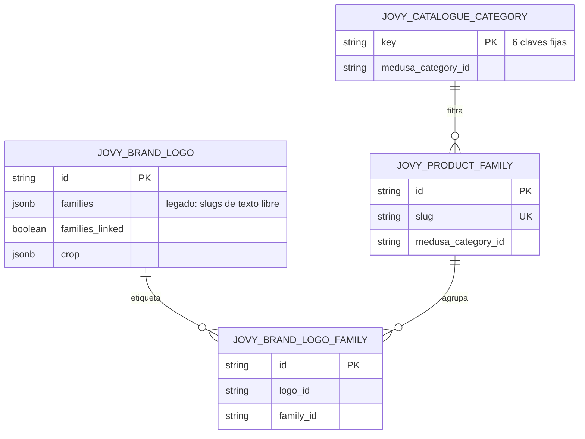

# Marketing Content en Medusa

## Estado real

- **Hero: IMPLEMENTADO Y VALIDADO.** La ruta `/app/jovy/marketing` permite alta, edición, publicación, despublicación, archivado, borrado físico sin restore, activación, vigencia UTC, orden, CTA, color por elemento, configuración global y producto destacado. La E2E Brave cubre ciclo editorial, media PNG/JPEG/WebP real, persistencia tras recarga, reordenamiento visible en Store y Product Link A→B→null con idempotencia.
- **Banners: IMPLEMENTADO Y VALIDADO.** La pestaña Banners cubre CRUD, publicación, archivado, borrado físico sin restore, slots `promo`/`hint`, prioridad, orden, programación UTC, frecuencia, `auto_open`, CTA, carga de imagen y contratos HTTP negativos. La E2E Brave verifica cada slot en Store y la exclusión de borradores, archivados y ventanas fuera de vigencia.
- **Novedades (eventos): IMPLEMENTADO Y VALIDADO.** La entidad sigue siendo `jovy_event`; «Novedades» es la bandeja multimedia (`/app/jovy/novelties`) y no un contenido nuevo. Admite imagen (PNG/JPEG/WebP ≤ 5 MB por el endpoint existente), GIF y vídeo MP4/WebM (≤ 100 MB por `POST /admin/jovy/events/media/video`). La Store expone `media_type` derivado (`image`/`gif`/`video`/`null`). El CRUD editorial completo continúa en Eventos Jovy.

## Diseño

```mermaid
flowchart LR
  A[Medusa Admin] --> B[/admin/jovy/marketing]
  B --> C[jovy_marketing]
  C --> D[(PostgreSQL)]
  C --> E[File Module local]
  P[Product Module] <-- Module Link --> H[Hero Item]
  S[Store API con Publishable API Key] --> C
```

- `HeroItem`: contenido ES/EN, estado, activación, orden, programación UTC, CTA, color e imagen opcional.
- `MarketingBanner`: contenido ES/EN, slots `promo`/`hint`, estado, activación, prioridad, orden, programación UTC, `auto_open` y frecuencia `every`/`session`/`daily`.
- `HeroSettings`: color visual global comprobado en el administrador histórico.
- `MarketingAuditLog`: mutaciones administrativas, sin exposición Store.

La Store API exige `published`, `enabled`, vigencia actual y ausencia de soft delete. El orden es determinista y se aplica con comparadores explícitos (`compareBannerOrder`, `compareHeroOrder`), no solo con el `ORDER BY` de la base de datos:

- Hero: `sort_order ASC`, `created_at ASC`, `id ASC`.
- Banners: `priority DESC`, `sort_order ASC`, `created_at ASC`, `id ASC`.

La prioridad de un Banner domina al reordenamiento: mover un Banner de prioridad baja al inicio cambia su `sort_order`, pero no lo coloca por encima de uno con `priority` mayor. `POST .../reorder` rechaza identificadores repetidos.

La lectura Store de la galería de marca aplica además un tope defensivo de `MAX_VISIBLE_GALLERY_ITEMS` (4) después del orden `sort_order ASC, created_at ASC`. La escritura ya bloquea la quinta publicación simultánea; si datos heredados o fuera de banda superan el tope, la API devuelve sólo los cuatro primeros y registra un warning operativo con conteos, sin títulos ni identificadores de archivo.

## APIs

| Ruta | Acceso | Uso |
| --- | --- | --- |
| `GET/POST /admin/jovy/marketing/hero` | sesión Admin | Lista y alta Hero |
| `GET/PUT/DELETE /admin/jovy/marketing/hero/:id` | sesión Admin | Lectura y CRUD lógico Hero |
| `POST /admin/jovy/marketing/hero/reorder` | sesión Admin | Reordenamiento Hero |
| `GET/PUT /admin/jovy/marketing/hero/settings` | sesión Admin | Color global Hero |
| `GET/PUT /admin/jovy/marketing/hero/:id/product` | sesión Admin | Consultar, reemplazar o retirar Product Link |
| `GET/POST /admin/jovy/marketing/banners` | sesión Admin | Lista y alta Banner |
| `GET/PUT/DELETE /admin/jovy/marketing/banners/:id` | sesión Admin | CRUD lógico Banner |
| `POST /admin/jovy/marketing/banners/reorder` | sesión Admin | Reordenamiento Banner |
| `POST /admin/jovy/marketing/media` | sesión Admin | PNG/JPEG/WebP, máximo 5 MB |
| `GET /admin/jovy/marketing/media/:id` | sesión Admin | Resolver URL de File Module para edición |
| `POST /admin/jovy/events/media/video` | sesión Admin | GIF/MP4/WebM, máximo 100 MB |
| `GET /store/jovy/marketing/hero` | Store API | Hero visible, con `media_url` resuelta cuando existe |
| `GET /store/jovy/marketing/banners/:slot` | Store API | Banners visibles por slot |
| `GET /store/jovy/events` | Store API | Eventos visibles con `media_url` y `media_type` derivado |

Los CTA aceptan solo rutas relativas o URLs `https:`; se bloquean `javascript:` y `data:`.

## Marca Jovy: logos, familias y categorías

### Modelo final



- `jovy_brand_logo_family` es la **fuente de verdad** de la relación logo ↔ familia. Guarda sólo
  `jovy_product_family.id`; nombre y slug no se duplican y se resuelven en lectura desde
  `jovy_catalogue`. No hay FK entre módulos: la existencia y `active` se validan al escribir.
- `families` (`jsonb string[]`) es el histórico de slugs de texto libre. No se borra ni se
  reescribe: se devuelve tal cual y lo que no tiene familia canónica se reporta en
  `unmapped_families`.
- `families_linked` distingue "nunca vinculado" (`false`: se lee y filtra con el array legado)
  de "vinculado explícitamente" (`true`: manda la tabla de relación, incluso vacía). Sin esa
  bandera, borrar todas las familias de un logo resucitaría los slugs heredados.
- La tabla vive en el módulo `jovy-brand` (no es Module Link) para que la lectura y la validación
  de escritura se resuelvan en una consulta local; Medusa crea las tablas de link después de las
  migraciones (`db:migrate` → `sync-links`). El backfill corre en un script posterior, no en la
  migración.
- Al borrar un logo se borran sus vínculos en el mismo workflow (`deleteBrandStep`): no hay FK
  que lo haga por nosotros. `Migration20261113170000` limpió los vínculos huérfanos acumulados
  antes de ese arreglo.

### Categoría → familias (Admin)

El selector de la pestaña **Logos** usa las seis claves fijas del catálogo
(`sazonador`, `chamoy`, `gomitas_almidon`, `dulces_paletas`, `pinatero`, `gomitas_grenetina`) y
consulta `GET /admin/jovy/catalogue/families?category_key=`. El endpoint resuelve la tarjeta de
catálogo y devuelve sólo las familias cuyo `medusa_category_id` coincide con
`jovy_catalogue_category.medusa_category_id`. Una tarjeta sin categoría comercial vinculada
devuelve una lista vacía: no se inventan familias ni se deduce la categoría por nombre.

Reglas de la pantalla:

- Selección múltiple persistente: checkboxes que escriben `family_ids`; al guardar se envía el
  conjunto completo y el backend aplica el diff.
- Las familias ya seleccionadas se siguen mostrando aunque el filtro de categoría las oculte
  (marcadas "fuera de la categoría"), para que guardar no pierda asociaciones en silencio.
- Un logo con `families_linked = false` muestra además la advertencia del legado no mapeado
  (`unmapped_families`) y no reenvía esos slugs: permanecen sólo como lectura hasta que se
  vinculen a una familia real.
- **Riesgo residual M2 (no corregido en esta entrega):** guardar cualquier logo legado desde el
  formulario envía `family_ids` y lo pasa a modo relación (`families_linked = true`) aunque el
  usuario no toque los checkboxes. Desde ese momento el filtro Store deja de aplicar los slugs
  no mapeados y el logo pierde esas asociaciones en silencio. Mitigación operativa: ejecutar
  `sync-brand-logo-families.ts` y revisar `unmapped_families` antes de editar logos legados.
- El recorte (`crop`) sigue siendo no destructivo: se guardan `zoom`, `offset_x` y `offset_y`,
  nunca se reescribe el archivo original.

### Reglas del filtro Store

`GET /store/jovy/brand/logos?family=` compara contra la relación real resuelta a `{ id, slug }`:

| Caso del logo | `family=<id o slug>` |
| --- | --- |
| Vinculado y con relación | coincide sólo con sus familias |
| Vinculado sin relación (`families_linked = true`, selección vacía) | se devuelve para cualquier familia |
| Nunca vinculado (`families_linked = false`) | coincide por slug exacto en el array legado |
| Sin relación ni legado | se devuelve para cualquier familia (decisión de esta entrega; el filtro anterior lo excluía) |

Sin el parámetro se devuelven todos los logos `enabled`, orden `sort_order ASC, created_at ASC`.
El parámetro repetido/array se ignora. La respuesta publica `family_ids` y `family_slugs`
resueltos y mantiene `families` (legado) sin cambios.

### Backfill explícito

`Migration20261113160000` sólo crea `jovy_brand_logo_family` y añade `families_linked`. **No
mapea** `families[]`: `jovy-brand` migra antes que `jovy-catalogue` (orden de módulos en
`medusa-config.ts`), así que `jovy_product_family` puede no existir todavía. El mapeo es un paso
de sincronización posterior e idempotente:

```powershell
# 1) Migraciones de catálogo y marca (crean las tablas canónicas)
pnpm --dir apps/backend exec medusa db:migrate
# 2) Familias canónicas y vínculos de catálogo
pnpm --dir apps/backend exec medusa exec ./src/scripts/sync-jovy-catalogue.ts
# 3) Backfill de familias de logos (idempotente)
pnpm --dir apps/backend exec medusa exec ./src/scripts/sync-brand-logo-families.ts
```

Reglas:

- Coincidencia exacta por slug contra una familia **activa** y vigente (`deleted_at is null`).
  Los slugs inactivos o inexistentes **no se borran**: siguen en `jovy_brand_logo.families` y
  se reportan como no mapeados. No se crean familias automáticamente.
- Un logo con `families_linked = true` no se reescribe; repetir el script no duplica vínculos.
- El script pagina logos y familias hasta agotar y registra en el log: logos, mapeados, ya
  vinculados, no mapeados y vínculos creados.
- En esta instancia no había logos al aplicar la migración: el reporte local fue
  `logos: 0, mapeados: 0, ya vinculados: 0, no mapeados: 0, vínculos creados: 0`.

Al borrar una familia del catálogo el vínculo no se elimina (la familia queda con soft delete, sin
restore expuesto hoy); la lectura resuelve sólo familias vigentes, así que ese logo deja de mostrar
la etiqueta y pasa a comportarse como "sin familias".

## Multimedia y Product Module

El File Module local usa `@medusajs/medusa/file-local`, con archivos en `static` y acceso público de laboratorio. No debe recibir material sensible: el proveedor no ofrece privacidad de lectura. La carga verifica tamaño (5 MB), firma/MIME y decodificación con `sharp`; rechaza SVG, firmas falsas, MIME declarado distinto del real, archivos corruptos y contenido inválido. Las APIs Store resuelven el archivo publicado a URL y degradan a `media_url: null` si un archivo local fue eliminado. La URL base del provider es `FILE_BACKEND_URL ?? http://localhost:${PORT ?? 9000}/static`, de modo que la suite E2E en otro puerto no queda atada al 9000. La validación de `sharp` no se relaja.

El Module Link `product.product <> jovy_marketing.jovy_hero_item` modela un producto para cada Hero y un producto reutilizable en varios Heroes. El workflow valida el nuevo producto antes de retirar el vínculo anterior y trata la misma selección como idempotente. La compensación de workflow retira el vínculo nuevo y restaura el anterior cuando una operación posterior falla; la función `compensateHeroProductLink` se prueba de forma unitaria y la E2E cubre A→B→null, repetición idempotente y conservación del vínculo ante un producto inexistente.

## Política multimedia por pantalla

Existen **dos endpoints de carga** con validaciones independientes:

| Endpoint | Archivo | Límite | Formatos | Validación |
| --- | --- | --- | --- | --- |
| `POST /admin/jovy/marketing/media` | `src/api/admin/jovy/marketing/media/route.ts` | 5 MB (`multer` en `src/api/middlewares.ts` + `file.size`) | PNG, JPEG, WebP | firma binaria + `sharp.metadata()` |
| `POST /admin/jovy/events/media/video` | `src/api/admin/jovy/events/media/video/route.ts` | 100 MB (`multer` + `Content-Length`) | GIF, MP4, WebM | firma binaria + MIME declarado idéntico al detectado |

Por qué el límite no se globaliza:

1. `sharp` no decodifica vídeo; reutilizar el validador de imagen obligaría a dejar de verificar el contenido real.
2. El resto de pantallas (Hero, Banners, Galería, Logos, Catálogo) sólo renderizan imagen; aceptar vídeo allí produciría archivos que la UI no puede mostrar.
3. Un cuerpo de 100 MB sólo se justifica donde existe un contrato de reproducción; se escribe a un directorio temporal con `multer.diskStorage`, no a `static` ni a memoria.
4. Los topes se aplican en capas: `Content-Length` antes de leer el cuerpo (413 inmediato), `LIMIT_FILE_SIZE` de `multer` durante la escritura y firma/tamaño dentro de la ruta.
5. Una sola subida de vídeo concurrente por proceso (lock) y un rate limit por usuario/IP (20 intentos / 10 min). La segunda subida simultánea y el exceso de intentos responden `429` con `Retry-After` cuando aplica.

Límites efectivos del carril de Novedades:

| Regla | Valor | Dónde se aplica |
| --- | --- | --- |
| Tamaño máximo | 100 MB (`100 * 1024 * 1024`) | `EVENT_VIDEO_MAX_BYTES` en `src/lib/jovy/events-media.ts`, `multer` y la ruta |
| Formatos aceptados | GIF, MP4, WebM | `detectEventVideoMime` (firma) + igualdad con el MIME declarado |
| Archivos por petición | 1 | `multer({ limits: { files: 1 } })` y `files.length !== 1` → error |
| SVG / PNG / JPEG / WebP por este endpoint | Rechazado con 400 | no hay firma admitida; las imágenes usan el endpoint de 5 MB |
| Cuerpo declarado por encima de 100 MB + margen | 413 | `exceedsEventVideoUploadLimit` antes de `multer` |
| Cuerpo real por encima de 100 MB sin declararlo | 413 `LIMIT_FILE_SIZE` | `multer.diskStorage` corta la escritura |
| Segunda subida simultánea | 429 | lock en proceso `acquireEventVideoUploadLock` |
| Más de 20 intentos / 10 min por usuario/IP | 429 | `consumeEventVideoUpload` |

Firmas verificadas:

| Tipo | MIME | Firma binaria |
| --- | --- | --- |
| GIF | `image/gif` | `GIF87a` o `GIF89a` |
| MP4 | `video/mp4` | box `ftyp` con marca MP4 (`isom`, `mp42`, `avc1`, `M4V `, `dash`…) o una marca MP4 en `compatible_brands` |
| WebM | `video/webm` | cabecera EBML `1A 45 DF A3` y DocType `webm` en los primeros 64 bytes |

Consumo por pantalla (cada una elige el endpoint según el tipo):

| Pantalla | Recurso | Tipo de archivo | Límite efectivo |
| --- | --- | --- | --- |
| Marketing → Hero | `jovy_hero_item.media_file_id` | imagen de fondo/arte | PNG/JPEG/WebP ≤ 5 MB |
| Marketing → Banners | `jovy_marketing_banner.media_file_id` | imagen de banner (`promo`/`hint`) | PNG/JPEG/WebP ≤ 5 MB |
| Marca Jovy → Galería Casa Jovy | `jovy_gallery_item.media_file_id` | imagen | PNG/JPEG/WebP ≤ 5 MB |
| Marca Jovy → Logos | `jovy_brand_logo.media_file_id` | imagen con recorte no destructivo (metadatos `crop`) | PNG/JPEG/WebP ≤ 5 MB |
| Catálogo | `jovy_catalogue_category.image_file_id` | imagen de tarjeta | PNG/JPEG/WebP ≤ 5 MB |
| Novedades (Eventos) | `jovy_event.media_file_id` | imagen, GIF o vídeo | PNG/JPEG/WebP ≤ 5 MB · GIF/MP4/WebM ≤ 100 MB |

Diferencias con el histórico: el Admin original permitía imágenes de hasta **20 MB** y vídeo de
hasta **100 MB**, este último sólo en Eventos (`event.routes.ts`, `docs/13-AUDITORIA-ADMIN-ORIGINAL.md`).
En esta entrega se iguala el vídeo (100 MB) para Novedades, pero la imagen mantiene **5 MB** en
todas las pantallas: subir el tope de imagen no forma parte de este bloque.

Ninguna otra pantalla requiere vídeo:

- **Logos** se recortan con `crop` (`zoom`, `offset_x`, `offset_y`) sobre una imagen fija; el
  archivo original nunca se reescribe, así que solo tiene sentido un raster transparente.
- **Banners y Hero** son imágenes de composición; un vídeo exigiría un `<video>` con póster,
  pausa y controles accesibles, y reglas de reproducción automática que hoy no existen.
- **Galería** limita a cuatro elementos visibles; el peso de un vídeo multiplicaría el costo de
  esa vista sin contrato de reproducción.
- **Novedades** sí tiene contrato de reproducción: la web histórica usaba el mismo carrusel
  horizontal multimedia y descartaba eventos sin medio. Por eso es la única pantalla con vídeo.

### Novedades: contrato Store y reparto de responsabilidades

`jovy_event` no cambia de forma: se sigue guardando `media_file_id`. El tipo se **deriva** en
lectura desde la URL pública del File Module (`eventMediaTypeFromUrl`), porque el módulo de
archivos sólo persiste `id` y `url`. Se mantienen `media_file_id` y `media_url`; se añade
`media_type` (`image`, `gif`, `video` o `null`). Las extensiones históricas `mov`, `m4v`, `ogg`
y `ogv` se leen como `video`.

Decisión de contrato en Store: `GET /store/jovy/events` **sigue devolviendo los eventos
publicados sin medio** con `media_type: null` y `media_url: null`. El carrusel histórico los
descartaba al pintar; la agenda de este backend los conserva porque un evento sin medio sigue
siendo información válida. El storefront debe filtrar por `media_type` si quiere reproducir el
comportamiento del carrusel. Un evento `draft`, `archived`, `cancelled`, deshabilitado o fuera de
ventana no aparece (`isEventVisible`).

Reparto entre pantallas:

| Responsabilidad | Novedades (`/app/jovy/novelties`) | Eventos Jovy (`/app/jovy/events`) |
| --- | --- | --- |
| Subir/reemplazar/retirar medio | Sí, elige endpoint según el tipo | También (sólo imágenes) |
| Preview reproducible | `` o `<video muted loop playsInline controls>` | `` |
| Activar/desactivar | Sí (`enabled`) | Sí |
| Prioridad y orden | Sí (edición numérica) | Sí, incluido reordenamiento por flechas |
| Textos, tipo, fechas, publicación, borrado | No | Sí |

La bandeja no borra archivos del File Module: retirar el medio sólo pone `media_file_id = null`
porque el almacenamiento local no tiene conteo de referencias y un archivo puede estar compartido.

Limitaciones conocidas del vídeo:

- `@medusajs/medusa/file-local` sirve archivos por HTTP sin soporte de rangos; el vídeo se
  reproduce en local (archivos pequeños), pero producción necesitaría un proveedor con ranges.
- No hay transcodificación: el navegador debe soportar el códec (H.264 en MP4, VP8/VP9 en WebM).
- No se genera póster ni miniatura; la primera reproducción depende del propio archivo.
- Mitigación y riesgo residual: el multipart ya no vive en memoria (`diskStorage` a un directorio
  temporal del sistema) y la firma se valida leyendo sólo 64 bytes. El pico restante es de
  **≈ 360 MB por subida**: la cadena base64 que exige el contrato de `uploadFilesWorkflow`
  (≈ 4/3 del archivo, ~133 MB para el tope de 100 MB) coexiste con el buffer decodificado de
  ~100 MB que `file-local` materializa para volver a escribir el archivo, más las copias
  temporales de la re-codificación. Para acotarlo hay **una sola subida de vídeo concurrente**
  (lock en proceso; la segunda responde `429`) y un **rate limit de 20 intentos / 10 min por
  usuario/IP** (`429` con `Retry-After`). El lock garantiza que el pico no se multiplique dentro
  de una instancia; con varias réplicas cada una tiene su propio lock y el riesgo residual sigue
  siendo por instancia. Para producción convendría un proveedor de archivos que acepte streaming
  o multipart directo.

Cualquier cambio de límites debe hacerse en los dos sitios de cada carril
(`src/api/middlewares.ts` y la ruta) y con pruebas de rechazo por tamaño y por tipo, sin relajar
la validación de firma de ninguno de los dos endpoints.

## Pendientes de prueba

- La frecuencia es un contrato editorial para el futuro storefront; el backend la persiste y expone, pero no afirma comportamiento de presentación sin storefront implementado.
- Los archivos no se borran físicamente al eliminar contenido: sin conteo de referencias global no es seguro eliminar recursos potencialmente compartidos. Las fixtures multimedia de E2E reutilizan archivos existentes o dejan el archivo huérfano a propósito; no se eliminan recursos compartidos.
- La ventana temporal se evalúa con el reloj UTC del servidor; una prueba con reloj simulado queda cubierta a nivel unitario, no con manipulación del reloj del proceso E2E.
- La E2E de Novedades usa fixtures reales generados con `ffmpeg` (WebM VP8, MP4 H.264 y GIF) y comprueba reproducción local y persistencia. No sustituye una prueba de streaming por rangos: el proveedor local no los soporta.
- `media_type` se deriva de la extensión de la URL pública. Si en el futuro otro proveedor sirve URLs sin extensión, hará falta persistir el MIME en el evento para no degradar a `media_type: null`.
