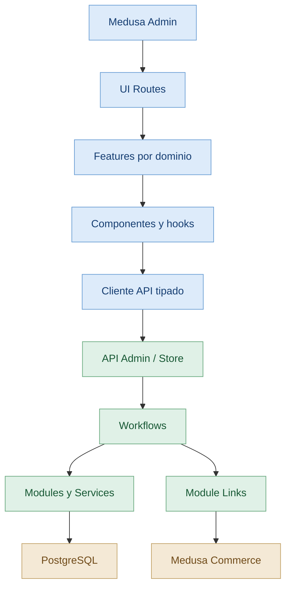
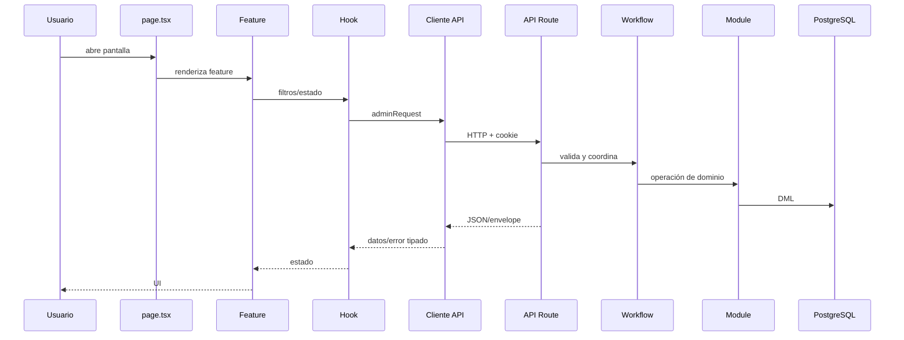

# Arquitectura modular de Medusa / JovyCandy

**Corte:** 2026-11-20
**Alcance:** backend Medusa y Admin. Storefront fuera de alcance.

## 1. Principio

La aplicación es un **monolito modular Medusa**. No se introducen puertos, adaptadores, repositorios ni fábricas que dupliquen lo que el framework ya resuelve. La autoridad es:



## 2. Capas

| Capa | Ubicación | Responsabilidad | No debe |
|---|---|---|---|
| UI Route | `src/admin/routes/**/page.tsx` | Registrar ruta, config y delegar render | Contener fetching, formularios o reglas |
| Feature | `src/admin/features/<dominio>/` | Componentes, hooks, API, tipos y helpers del dominio | Importar componentes privados de otra feature |
| Shared Admin | `src/admin/shared/` | HTTP, medios, color, diálogo, cabecera | Conocer reglas de un dominio |
| Admin Widget | `src/admin/widgets/` | Punto de extensión nativo de Medusa | Duplicar una pantalla completa |
| API Route | `src/api/{admin,store}/jovy/**` | Validar, invocar workflow/servicio y responder | Implementar reglas de negocio |
| Workflow | `src/workflows/jovy-*` | Coordinar pasos, transacciones, compensación, auditoría y links | Renderizar o leer `req`/`res` |
| Module | `src/modules/jovy-*` | Modelo DML, persistencia y reglas del dominio | Importar modelos de otro módulo |
| Lib de dominio | `src/lib/jovy/*` | Reglas puras, esquemas y helpers del dominio | Depender de React o Express |

## 3. Árbol del Admin

```text
src/admin/
├── routes/                     # Solo registro de rutas y widgets
│   ├── jovy/...
│   └── jovy-herramientas/...
├── features/
│   ├── announcements/          # Banners promo/hint
│   │   ├── api.ts
│   │   ├── types.ts
│   │   └── components/{banner-manager,banner-card,banner-form}
│   ├── contacts/
│   │   ├── api/contacts-api.ts
│   │   ├── hooks/use-contact-query.ts
│   │   └── components/{contact-inbox,contact-table,contact-*-dialog}
│   ├── logos/
│   │   ├── api.ts
│   │   ├── types.ts
│   │   ├── lib/crop.ts
│   │   └── components/{logo-manager,logo-card,logo-form,crop-modal}
│   └── novelties/              # Misma estructura cuando aplique
├── shared/
│   ├── components/{admin-dialog,page-header}
│   └── lib/{admin-api,media,color}
├── widgets/product-editorial.tsx
└── styles/jovy-quality.css
```

Las rutas de `features/` se importan con el alias `@admin/*`. `page.tsx` sigue en la ubicación que Medusa descubre.

## 4. Árbol del backend

```text
src/
├── api/
│   ├── admin/jovy/{content,marketing,events,brand,catalogue,launches,contacts,products}
│   ├── store/jovy/
│   └── middlewares.ts
├── modules/
│   └── jovy-{content,marketing,events,brand,catalogue,launches,contacts,product-editorial}
├── workflows/
│   └── jovy-*/
├── links/
├── jobs/
├── subscribers/
└── lib/jovy/
```

## 5. Responsabilidades por dominio

| Dominio | Módulo | Workflows | Admin feature | Store |
|---|---|---|---|---|
| Contenido | `jovy-content` | create/update/delete page | `content` | páginas publicadas |
| Marketing | `jovy-marketing` | hero, banners, settings, product link | `marketing`, `announcements` | hero, banners, mensaje |
| Eventos | `jovy-events` | event, type, reorder, delete | `events`, `novelties` | eventos vigentes |
| Marca | `jovy-brand` | gallery, logo, reorder, delete | `gallery`, `logos` | galería y logos |
| Catálogo | `jovy-catalogue` | category, family, seed, reorder | `catalogue` | categorías/familias |
| Lanzamientos | `jovy-launches` | launch, settings, reorder | `launches` | activos |
| Contactos | `jovy-contacts` | create/update/delete/restore | `contacts` | solo POST público |
| Producto editorial | `jovy-product-editorial` | editorial/restore | widget | ficha publicada |

## 6. Reglas de dependencia

### Frontend

```text
routes -> features -> shared
```

- Una feature no importa `features/otra/components/*`.
- Si dos features necesitan lo mismo, se promueve a `shared` solo con dos consumidores reales.
- `shared` no importa features ni API de dominio.
- No se importan módulos Node ni `src/modules/**` en el bundle de Vite.
- Los imports profundos se evitan con `@admin/*`.

### Backend

```text
api -> workflows -> modules
```

- Un módulo no importa modelos ni servicios privados de otro.
- Las relaciones entre dominios usan Module Links, `product_id` o `file_id` como referencias.
- Las lecturas simples usan Module Service o Query; no se crean workflows artificiales.
- Los workflows coordinan varios pasos y conservan idempotencia/compensación cuando ya existe.
- Las rutas validan con los esquemas de `src/lib/jovy` y traducen errores; no contienen reglas de negocio.

## 7. Flujo de una petición



## 8. Decisiones y alternativas descartadas

| Decisión | Alternativa descartada | Motivo |
|---|---|---|
| Monolito modular Medusa | Microservicios | No hay límites de despliegue/escala que lo justifiquen |
| Module Service + DML | Repositorios/adaptadores propios | Duplican Medusa |
| Workflows solo para coordinación | Workflow por cada lectura | Añade ceremonia sin valor |
| `@admin` alias | Cadenas `../../../` o `@jovy` | Vite no resolvía `@jovy`; el alias es explícito |
| Shared mínimo | `utils` genérico | Evita un nuevo cajón desastre |
| Hook por consulta de servidor | Estado global/caché propio | El Admin ya usa fetch; se extrae sin reescribir todo |

## 9. Pruebas

| Capa | Herramienta | Qué cubre |
|---|---|---|
| Reglas puras | Jest unit | esquemas, orden, visibilidad, CSV/XLSX, helpers |
| Módulos | Jest integration modules | persistencia, locks, restore, queries |
| HTTP | Jest integration http | contratos Admin/Store |
| UI | Playwright E2E | ciclos de pantalla, navegación, modales, Store |
| Tipos | `tsc --noEmit` | contratos y alias |
| Build | `medusa build` | Vite + backend + descubrimiento |

## 10. Cómo añadir una feature

1. Crear `src/admin/features/<dominio>/{api,components,hooks,types}` solo con las carpetas necesarias.
2. Crear `routes/.../page.tsx` con `defineRouteConfig` y render de la feature.
3. Usar `adminRequest` y `errorMessage` de `shared`.
4. Extraer un hook solo si hay estado de servidor o flujo propio.
5. Reutilizar `AdminDialog` y `PageHeader` antes de duplicar.
6. Mantener testids, textos y tokens.
7. Añadir unit/E2E si cambia comportamiento visible.
8. Ejecutar typecheck, lint, unit, E2E y build.
