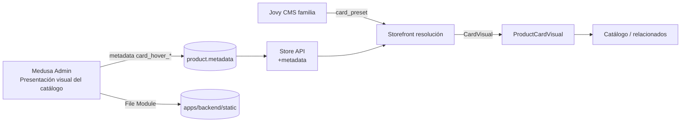

# Product Card Visual Manager

**Estado:** IMPLEMENTADO EN LABORATORIO.
**Alcance:** efectos visuales de las tarjetas del catálogo. No modifica precios, variantes, inventario, carrito ni checkout.
**Casos de regresión:** Jovy Rings Manzana Verde (`jovy-aros-manzana-verde`) conserva su explosión de gomitas.

## 1. Arquitectura



- **Medusa**: dueño de URLs, archivos y configuración por producto.
- **Jovy CMS**: dueño de familias y su preset heredado (`jovy_product_family.card_preset`).
- **Storefront**: resuelve el efecto final y renderiza; no guarda medios ni reglas de producto.

Decisiones:

- No se creó backend paralelo, tabla de efectos ni migración de datos comercial.
- Única migración aditiva: columna nullable `card_preset` en `jovy_product_family`.
- No se usan librerías de animación; CSS + React.

## 2. Contrato de metadata

Compatibilidad total con las claves anteriores:

| Clave | Tipo | Uso |
|---|---|---|
| `card_hover_enabled` | boolean | `false` fuerza `none`; se conserva por compatibilidad |
| `card_hover_mode` | `zoom` \| `swap` \| `layered` \| `none` | Efecto explícito del producto |
| `card_hover_preset` | `jovy-default` \| `jovy-gummies` \| `jovy-swap` \| `jovy-none` | Preset elegido |
| `card_hover_swap_url` | URL | Imagen alternativa para `swap` |
| `card_hover_overlay_url` | URL | Capa decorativa para `layered` |
| `card_hover_full_url` | URL | Composición completa opcional |
| `card_hover_background` | `#RGB`/`#RRGGBB` | Fondo de la tarjeta |
| `card_hover_duration_ms` | 150–900 | Duración de transición |
| `card_hover_intensity` | 0–150 | Intensidad de movimiento (100 = base) |
| `card_visual_version` | número | Versión del esquema |

Reglas:

- Solo se proyectan claves `card_hover_*`/`card_visual_version`; el resto de metadata no viaja al componente.
- Marcadores (`URL_REAL`, `REPLACE_ME`, `TODO`), URLs no `http(s)` y colores inválidos se descartan.
- Medusa fusiona metadata de primer nivel; el Admin envía el objeto completo para no perder claves ajenas.

## 3. Resolución del efecto

`apps/storefront/src/lib/commerce/card-visual.ts` expone un resolver puro:

```text
modo explícito del producto
  > preset del producto
  > preset de familia (Jovy CMS)
  > preset global (Jovy Default)
  > zoom
```

- `layered` sin overlay válido → `zoom`.
- `swap` sin imagen alternativa válida → `zoom`.
- Modo o preset desconocido → comportamiento seguro (`zoom`).
- `none` explícito se respeta.
- El resultado incluye `source` (`product`, `family`, `global`) para diagnóstico.

## 4. Motor visual

Componente: `apps/storefront/src/features/catalog/product-card-visual.tsx`.

| Modo | Comportamiento |
|---|---|
| `zoom` | Escala discreta (≈1.04) sobre `transform`, sombra de tarjeta y fondo configurable. |
| `swap` | Crossfade con la imagen alternativa; sin cambios de caja. |
| `layered` | Capa decorativa detrás de la bolsa; opacidad, desplazamiento y escala moderada. La bolsa no cambia de tamaño. |
| `none` | Sin animación ni fondo. |

- Variables CSS: `--visual-duration`, `--visual-intensity`, `--visual-scale`, `--card-hover-bg`.
- Se animan solo `opacity` y `transform`.
- `prefers-reduced-motion`: transiciones desactivadas y zoom sin escala.
- Hover solo en `@media (hover: hover)`; teclado mediante `:has(.catalog-card__image:focus-visible)`.
- Capas decorativas `alt=""`, `aria-hidden="true"`, `loading="lazy"`, `fetchPriority="low"`.
- Primeras cinco tarjetas con `loading="eager"` y prioridad alta.
- Si una capa falla (`onError`), se desmonta y queda la bolsa.

## 5. Admin: Presentación visual del catálogo

Widget: `apps/backend/src/admin/widgets/product-card-visual.tsx` (zona `product.details.after`).

Además, `apps/backend/src/admin/widgets/product-workspace.tsx` (`product.details.before`) añade una barra flotante con estado de producto/ficha/visual, anclas a Editorial y Visual y “Guardar cambios” compartido entre widgets.

Contenido:

- Selector de preset y de efecto (incluye heredar).
- Campos de imagen para `swap` y `layered`; carga directa al File Module.
- Preset de familia editable desde el mismo panel; afecta a los productos que lo heredan.
- Fondo, duración e intensidad.
- Vista previa con estado normal y hover (botón «Mantén para ver hover»).
- Guardado que preserva metadata ajena.
- «Restablecer herencia» elimina las claves visuales al guardar.

Flujo administrativo:

```text
Producto en Admin
  → Presentación visual del catálogo
  → elegir preset/efecto
  → subir imágenes (PNG/WebP)
  → ajustar fondo/duración
  → Guardar configuración
  → Storefront lee metadata en la siguiente petición
```

Validaciones del Admin:

- Tipo/tamaño de archivo mediante el carril dedicado `/admin/jovy/product-card-visual/media` (PNG/WebP hasta 5 MB, firma + MIME + `sharp`).
- URLs reales devueltas por Medusa; sin rutas locales del frontend.
- No se toca `product.images` ni el thumbnail.
- No hay cargas duplicadas: el botón se bloquea mientras sube/guarda.

## 6. Presets

Built-in en `card-visual.ts`:

| Preset | Modo | Duración |
|---|---|---|
| `jovy-default` | zoom | 350 ms |
| `jovy-gummies` | layered | 450 ms |
| `jovy-swap` | swap | 350 ms |
| `jovy-none` | none | 0 ms |

- El producto puede elegir preset y sobrescribir campos.
- La familia puede definir `card_preset`; el producto hereda sin duplicar metadata.
- Un cambio en el producto no altera a los demás productos de la familia.
- Familias: `jovy_product_family.card_preset` (migración `Migration20261123200000`), expuesta en `/store/jovy/catalogue/families` y en `/store/jovy/products`.

## 7. Gestión de imágenes

- Provider actual: `file-local` (`apps/backend/static`, fuera de Git).
- Carril dedicado: `/admin/jovy/product-card-visual/media` con permiso `jovy_catalogue:update`.
- Se aceptan PNG transparente y WebP hasta 5 MB, validando firma, MIME y decodificación con `sharp`.
- Archivos huérfanos posibles si se sube y no se guarda: permanecen en `static/`; limpieza manual/documentada, nunca automática para no borrar archivos compartidos.
- Producción: sustituir `file-local` por S3/almacenamiento persistente y conservar las mismas URLs en metadata. No ejecutado en esta campaña.

## 8. Migración de Rings

- Conserva URLs, composición y capas actuales.
- Su metadata ahora incluye `card_hover_preset: jovy-gummies`, `card_visual_version` y `card_hover_duration_ms`.
- El storefront ya no tiene lógica específica por handle: Rings usa el mismo motor y contrato que cualquier producto.

## 9. Pruebas

- **Resolver**: `apps/storefront/e2e/card-visual.spec.ts` (13 casos): sin configuración, zoom, swap, layered, none, fallbacks, preset de familia, prioridad de producto, valores desconocidos, compatibilidad Rings y metadata ajena.
- **E2E catálogo**:
  - capa decorativa de Rings desde Medusa, hover 0→1, misma caja, teclado, error de capa;
  - producto sin configuración con `zoom`;
  - `prefers-reduced-motion`;
  - cards y navegación intactas.
- **Estáticas**: typecheck backend/storefront, lint, build.

Resultados de la última ejecución:

| Suite | Resultado |
|---|---|
| E2E storefront (resolver + catálogo) | 25/25 |
| Unitarias backend (Jovy + familias) | 269/269 |
| Typecheck backend/storefront | PASS |
| Build backend (incluye Admin Vite) | PASS |
| Build storefront | PASS |
| Lint | 0 errores |
| E2E Admin autenticado | 1/1 (`jovy-product-card-visual.spec.ts`) |
| E2E backend completo | 32/32 |

El E2E del Admin inicia sesión real, cambia el efecto a `zoom`, guarda, recarga, comprueba persistencia vía API, edita el preset de la familia, sube una imagen por el carril dedicado, valida la URL en metadata y restaura producto y familia al estado original (incluyendo claves ausentes).

## 10. Limitaciones

- La asignación de preset por familia se edita desde el panel del producto; no existe una pantalla independiente de familias.
- La vista previa del Admin replica estilos, no importa el componente del storefront.
- Persistencia local de archivos no es apta para producción multi-instancia.

## 11. Validación manual

1. `pnpm --dir apps/backend seed:card-hover` (si se reconfigura Rings).
2. `pnpm dev`.
3. Admin → Productos → Rings → *Presentación visual del catálogo*: verificar preset/efecto y vista previa.
4. Storefront `/es/catalogo`: Rings muestra gomitas al hover; el resto de tarjetas hace zoom.
5. Producto sin metadata: solo zoom, sin errores de consola.
6. Navegar con teclado y activar movimiento reducido en el sistema.
