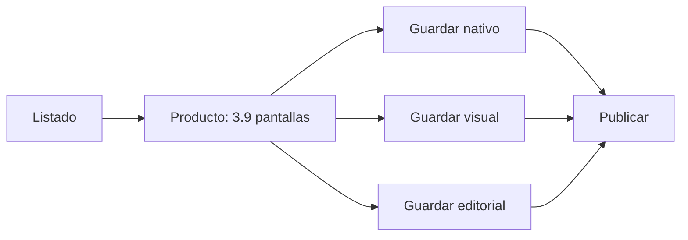
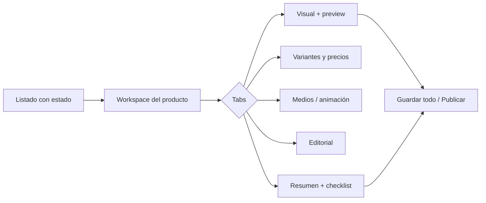

# Auditoría UX/UI — Administración de productos (Medusa Admin)

**Fecha:** 2026-11-24
**Estado:** IMPLEMENTADO EN LABORATORIO — auditoría y optimización P0–P2 parcial.
**Método:** inspección del código del Admin + recorrido real con Playwright y Brave en `1440 × 900`, sesión autenticada, producto `Aros Sabor Manzana Verde`.

## 1. Evidencia medida

| Métrica | Valor actual |
|---|---|
| Alto del detalle de producto | **3 265 px** |
| Viewport útil del panel | **847 px** |
| Pantallas de scroll para recorrer el detalle | **≈ 3,9** |
| Widget “Presentación visual” | inicia en y=1 281, alto **830 px** |
| Editor editorial | inicia en y=2 147, termina ≈ y=3 400 |
| Controles en la página | 14 inputs, 3 selects, 52 botones |
| Listado de productos | 20 filas, sin miniaturas visibles, sin filtros guardados |
| Alta de producto | wizard nativo de 3 pasos (Detalles / Organizar / Variantes) |

Orden vertical actual del detalle:

```text
Producto (nativo)
├── Resumen / Media / Options / Variants
├── Metadata / JSON
├── Presentación visual del catálogo   ← widget Jovy
└── Editor editorial Jovy              ← widget Jovy
```

Los dos widgets Jovy se apilan al final del formulario nativo. Cada uno tiene **su propio guardado**, su propio estado de error y ninguna barra de acciones persistente.

## 2. Hallazgos priorizados

### HIGH

#### H1. Edición monolítica de casi cuatro pantallas
**Dónde:** detalle nativo + `apps/backend/src/admin/widgets/product-editorial.tsx` (`product.details`) + `product-card-visual.tsx` (`product.details.after`).

**Problema:** para cambiar precio, stock, familia editorial y animación hay que recorrer 3,9 pantallas. Los botones “Guardar” viven al final de cada bloque; si el usuario corrige un campo arriba y no baja, no descubre el error.

**Consecuencia:** pérdida de cambios, doble guardado, errores de validación fuera de vista, sensación de lentitud.

**Fix mínimo:** navegación de anclas fija (“Resumen · Variantes · Medios · Editorial · Visual · Canales”) + barra de acciones sticky con estado “cambios sin guardar”.

#### H2. Tres fuentes de verdad visual sin jerarquía
**Dónde:** `Options` nativo, `Variants`, `Editor editorial → gramaje` y widget visual.

**Problema:** la opción nativa aún muestra `6 oz` junto a `170 g / 250 g / 500 g`; el gramaje editorial repite el dato; el widget visual habla de “preset” y “efecto” con dos selectores.

**Consecuencia:** el operador no sabe qué campo manda; se duplican presentaciones y se edita el lugar equivocado.

**Fix mínimo:** limpiar valores heredados (`6 oz`), marcar el origen de cada dato (“Medusa” / “CMS”) y mostrar una sola presentación principal con enlace a la fuente.

#### H3. Guardados independientes y sin estado global
**Dónde:** `useProductEditorial`, `saveProductVisual`, guardado nativo de Medusa.

**Problema:** el widget visual puede guardar mientras el editorial tiene cambios sin guardar; no existe indicador global ni advertencia al salir.

**Consecuencia:** configuraciones parciales y estados inconsistentes.

**Fix mínimo:** indicador por bloque (“Guardado / Sin guardar / Error”), confirmación al abandonar y un resumen superior con el estado de cada bloque.

#### H4. El preset de familia se cambia desde un producto
**Dónde:** `product-card-visual-widget.tsx`, bloque “Preset de familia”.

**Problema:** una acción que afecta a toda la familia vive dentro de un producto, sin mostrar cuántos productos impacta ni confirmación.

**Consecuencia:** cambios masivos accidentales; el usuario cree que edita solo ese producto.

**Fix mínimo:** moverlo a una pantalla “Presets de familia”, o añadir contador (“afecta a 9 productos”), confirmación y enlace “ver productos afectados”.

#### H5. Listado de productos pobre para operación diaria
**Dónde:** `/app/products` nativo.

**Problema:** sin miniatura visible, sin familia, sin precio, sin estado editorial/visual, sin vistas guardadas. Productos demo y fichas DEMO aparecen al principio. No hay acciones masivas.

**Consecuencia:** buscar un producto para editarlo requiere entrar uno por uno; el catálogo real se pierde entre datos de laboratorio.

**Fix mínimo:** columnas configurables (miniatura, familia, precio, estado editorial, efecto visual), filtro “solo catálogo Jovy”, ocultar demos por defecto y acciones masivas de preset.

### MEDIUM

#### M1. Widget visual correcto pero largo y con controles duplicados
- Dos selectores “Preset” (producto y familia) sin explicar la precedencia.
- Inputs de URL truncados; no hay copiar/ver completo.
- Carga por botón “Subir imagen”, sin drag & drop ni miniatura de mayor tamaño.
- “Mantén para ver hover” queda lejos de la vista previa.

**Fix:** una fila “Preset + Efecto”, campos dinámicos solo del modo activo, dropzone con preview 96 px, botón *Probar hover* dentro de la tarjeta.

#### M2. Editor editorial desaprovecha el ancho
`editorial-form.tsx` usa `max-w-4xl`; a 1440 px deja ~35 % del espacio vacío mientras el formulario se alarga. Cuatro secciones apiladas con copy explicativo repetido.

**Fix:** dos columnas internas (contenido/publicación | catálogo/estado), copy en tooltip, guardado sticky.

#### M3. Variantes y precios en una tabla profunda
La tabla de variantes exige abrir una fila para editar precio/stock; el flujo “crear producto → variantes → precios” son tres pasos sin resumen final.

**Fix:** drawer lateral de variante con precio, stock, SKU y presentación; guardado inline; resumen antes de publicar.

#### M4. Medios sin separación conceptual
La galería mezcla packshots, composición de hover y gomitas sueltas. El operador no distingue “imagen de producto” de “recurso de animación”.

**Fix:** dos pestañas: *Galería del producto* y *Recursos de animación*; validación de lienzo/transparencia.

#### M5. Estado de publicación fragmentado
Los requisitos `SELLABLE` solo se ven dentro del editor editorial; el estado del producto y el estado visual no se resumen arriba.

**Fix:** checklist único en el encabezado: publicado, precio, stock, imagen, ficha editorial, visual configurado.

#### M6. Alta de producto sin paso Jovy
El wizard nativo crea el producto, pero editorial y visual requieren una segunda visita. Todo producto nuevo recibe `zoom` por defecto, pero el operador no lo ve al crearlo.

**Fix:** paso opcional “Presentación Jovy” al final del wizard con defaults y “configurar después”.

### LOW

- Mezcla ES/EN: “Media”, “Options”, “Variants”, “Sales Channels” conviven con “Presentación visual”, “Editor editorial”.
- Metadata/JSON nativos expuestos antes de los widgets; ruido técnico para operación.
- Botonera heterogénea (tamaños, orden y jerarquía distintos entre widgets).
- Sin estado vacío útil en “Composición completa” (opcional) más allá del placeholder.
- Sin atajos de teclado ni foco inicial en el primer error.

## 3. Flujo actual vs. flujo objetivo



Objetivo:



Wireframe propuesto (escritorio):

```text
┌ Producto · Ositos Surtidos ─────────────── [Ver en tienda] [Publicar] ┐
│ [Resumen] [Variantes] [Medios] [Editorial] [Visual] [Canales]        │
├──────────────────────────────────────┬───────────────────────────────┤
│ Contenido del tab activo             │ Estado de publicación          │
│ (formulario compacto, 1 columna)     │ ✓ Precio  ✓ Stock              │
│                                      │ ✓ Ficha   ✓ Visual             │
│                                      │                               │
│                                      │ Vista previa de tarjeta        │
│                                      │ (hover real, sticky)           │
├──────────────────────────────────────┴───────────────────────────────┤
│ ● Cambios sin guardar        [Descartar]        [Guardar cambios]    │
└──────────────────────────────────────────────────────────────────────┘
```

## 4. Backlog recomendado

| Prioridad | Mejora | Impacto | Esfuerzo |
|---|---|---|---|
| P0 | Barra sticky con estado global y guardar por bloque | Evita pérdidas y errores | M |
| P0 | Navegación por anclas/tabs + resumen de estado | Reduce scroll de 3,9 a ≤1,5 pantallas | M |
| P0 | Limpiar `6 oz` y ordenar presentación única | Elimina ambigüedad de datos | S |
| P1 | Compactar widget visual (modo dinámico, preview con botón hover) | Configuración <60 s | S |
| P1 | Mover preset de familia a pantalla propia con impacto | Evita cambios masivos | M |
| P1 | Columnas de listado: miniatura, familia, precio, editorial, visual | Encontrar productos sin abrir fichas | M |
| P1 | Separar “Galería” de “Recursos de animación” | Claridad de medios | S |
| P2 | Drawer de variante con precio/stock | Menos navegación | M |
| P2 | Checklist único de publicación | Menos idas y vueltas | M |
| P2 | Paso “Presentación Jovy” en alta | Producto nuevo listo de una vez | M |
| P2 | i18n del Admin Jovy y limpieza de metadata/JSON | Consistencia | S |

## 5. Criterios de aceptación propuestos

- Configurar un producto existente (efecto + familia + imagen) en **≤ 60 s** y **≤ 1,5 pantallas** de scroll.
- Cero cambios perdidos: cualquier bloque con cambios muestra estado y bloquea la salida.
- Un cambio de preset de familia requiere confirmación y muestra **N productos afectados**.
- El listado permite filtrar “solo catálogo Jovy” y ver estado editorial/visual sin abrir el producto.
- Un producto creado puede quedar con visual por defecto sin una segunda edición.
- Teclado: foco visible, orden lógico y errores anunciados en el bloque correspondiente.

## 6. Recomendación de implementación

**No reescribir el Admin nativo.** Evolución incremental:

1. Widget superior compacto “Jovy Workspace” con anclas, checklist y estado de guardado.
2. Mover la vista previa visual a la columna lateral sticky (`product.details.side.*`) y dejar el formulario completo en un modal/pestaña.
3. Compactar el widget visual con campos condicionales por modo y preview accionable.
4. Presets de familia en pantalla propia dentro de JovyCandy CMS.
5. Columnas y filtros del listado mediante configuración del Admin nativo.

Trade-off: un producto-page 100 % propio daría el mejor control, pero duplicaría formularios nativos y elevaría el riesgo de regresión; no se recomienda en esta etapa.

## 7. Implementación P0 (esta iteración)

Implementado sin reescribir el Admin nativo:

- **Barra flotante de trabajo** (`product-workspace-bar.tsx`) en todas las fichas: producto, estado editorial, modo visual, accesos a Editorial/Visual y botón “Guardar cambios (N)”.
- **Estado global de cambios** mediante un store compartido entre widgets (`features/product-workspace/store.ts`): cada bloque registra `dirty`, `saving` y su acción de guardado.
- **Aviso beforeunload** cuando hay cambios sin guardar.
- **Anclas funcionales** a los bloques Editorial y Visual con `scroll-margin`.
- **Estado vivo**: el badge visual y el editorial se actualizan al editar, no solo al recargar.
- **Limpieza de presentaciones heredadas**: `seed:catalog` retira valores como `6 oz`; el Admin muestra solo `170 g / 250 g / 500 g`.

Archivos principales:

- `apps/backend/src/admin/features/product-workspace/store.ts`
- `apps/backend/src/admin/features/product-workspace/components/product-workspace-bar.tsx`
- `apps/backend/src/admin/widgets/product-workspace.tsx` (zona `product.details.before`)
- `product-editorial-widget.tsx` y `product-card-visual-widget.tsx`: registro de bloques, ids de ancla, estado dirty y padding inferior.
- `use-product-editorial.ts`: estado `dirty` y reset al guardar.
- `seed-jovy-catalog.ts`: retiro de valores de opción sin variante.

Validación P0:

| Check | Resultado |
|---|---|
| E2E Admin del producto | 1/1: barra fija, “sin guardar”, guardado global, ancla Visual, familia, imagen y restauración |
| Suite backend completa | 31/32; fallo aislado de Hero por dato temporal, re-ejecutado 1/1 |
| Typecheck backend | PASS |
| Build backend + Admin | PASS |
| `seed:catalog` | limpia `6 oz` y valores heredados; options quedan en gramos |

La barra fija no reduce todavía el largo físico del formulario (sigue en 3 265 px); elimina la necesidad de bajar para guardar y da estado/navegación. Reducirlo a ≤1,5 pantallas requiere el bloque P1 (tabs/compactación).

## 8. Validación manual

1. `pnpm --dir apps/backend seed:catalog` (limpia presentaciones heredadas).
2. Abrir un producto: la barra flotante aparece abajo a la derecha.
3. “Editorial” / “Visual” llevan al bloque correspondiente.
4. Cambiar un efecto: aparece “1 bloque sin guardar”; “Guardar cambios” persiste y limpia el estado.
5. Cambiar y recargar/cerrar: el navegador advierte cambios pendientes.
6. Verificar que `Options` ya no muestra `6 oz`.

## 9. Compactación aplicada (P1 parcial)

Se rediseñaron los dos paneles sin cambiar endpoints:

**Presentación visual**
- Preset y Efecto en una fila de dos columnas.
- Familia en una sola línea con selector + “Guardar familia” (sin párrafo explicativo).
- Recursos condicionales según el modo efectivo: `zoom/none` no muestran imágenes.
- Tarjeta de recurso compacta con miniatura, drag & drop, “Subir imagen” y “Quitar”; la URL queda en una línea secundaria.
- “Composición completa” colapsada; “Ajustes avanzados” (fondo/duración/intensidad) colapsados con resumen visible.
- Vista previa con botón **Probar hover / Ver reposo** y una sola línea de contexto.
- Copy reducido a “Tarjeta del catálogo · no altera precios, stock ni galería”.

**Editor editorial**
- Formulario en dos columnas en escritorio: modalidad + presentación | catálogo + publicación.
- Modalidad en una fila con badge y select; requisitos como chips.
- Gramaje/Orden/Novedad en una cuadrícula compacta; certificaciones como pills.
- Catálogo resumido en badges con enlace.
- Publicación compacta; acciones destructivas dentro de “Opciones de eliminación”.
- Gramaje editorial migrado a gramos (`170 g`) desde el seed.

**Métricas después del cambio**

| Métrica | Antes | Después |
|---|---|---|
| Scroll total del detalle | 3 265 px | **2 641 px** (−19 %) |
| Pantallas de scroll | ≈ 3,9 | **≈ 2,8** |
| Alto widget visual | 830 px | **683 px** (−18 %) |
| Alto editor editorial | ≈ 1 250 px | **706 px** (−44 %) |

Validación: E2E `jovy-product-card-visual` + `jovy-product-editorial` **2/2**, typecheck y build del backend/Admin PASS.

## 10. Divulgación de detalles nativos (P2 parcial)

Sin forkear el Admin, la barra de trabajo ahora compacta de inicio tres bloques técnicos nativos:

- `Options`, `Metadata` y `JSON` comienzan cerrados, pero conservan todos sus campos y solicitudes nativas.
- **Mostrar técnicos / Ocultar técnicos** alterna los tres bloques de una vez.
- Cada bloque tiene un control propio **Mostrar / Ocultar**, accesible por teclado y con estado `aria-expanded`.
- La composición interna de esos bloques no se duplica ni se reimplementa: el widget solo añade divulgación reversible al DOM renderizado por Medusa.
- La preview visual se mantiene en columna lateral en escritorio mientras se recorren sus ajustes; en móvil vuelve al flujo normal.

Medición con navegador real para la ficha de referencia:

| Bloque nativo | Expandido | Compacto |
|---|---:|---:|
| `Options` | 121 px | **60 px** |
| `Metadata` | 60 px | **56 px** |
| `JSON` | 60 px | **56 px** |

La reducción grande sigue dependiendo de secciones nativas más pesadas como Media y Variants. No se ocultan por defecto porque forman parte del flujo comercial cotidiano.

Validación: E2E real verifica estado inicial, expansión global, toggle individual por `Enter` y restauración; `jovy-product-card-visual` + `jovy-product-editorial` **2/2** PASS.

## 11. Limitaciones de esta auditoría

- Un solo producto y una sola resolución de escritorio; el Admin de Medusa es desktop-first.
- Sin pruebas con usuarios reales ni medición de tiempos de tarea.
- Los componentes nativos de Medusa no son modificables sin fork; las propuestas se apoyan en widgets, zonas y configuración.
- Sin fork de Medusa no hay una API de zonas para reordenar o convertir todos sus paneles nativos en tabs.
